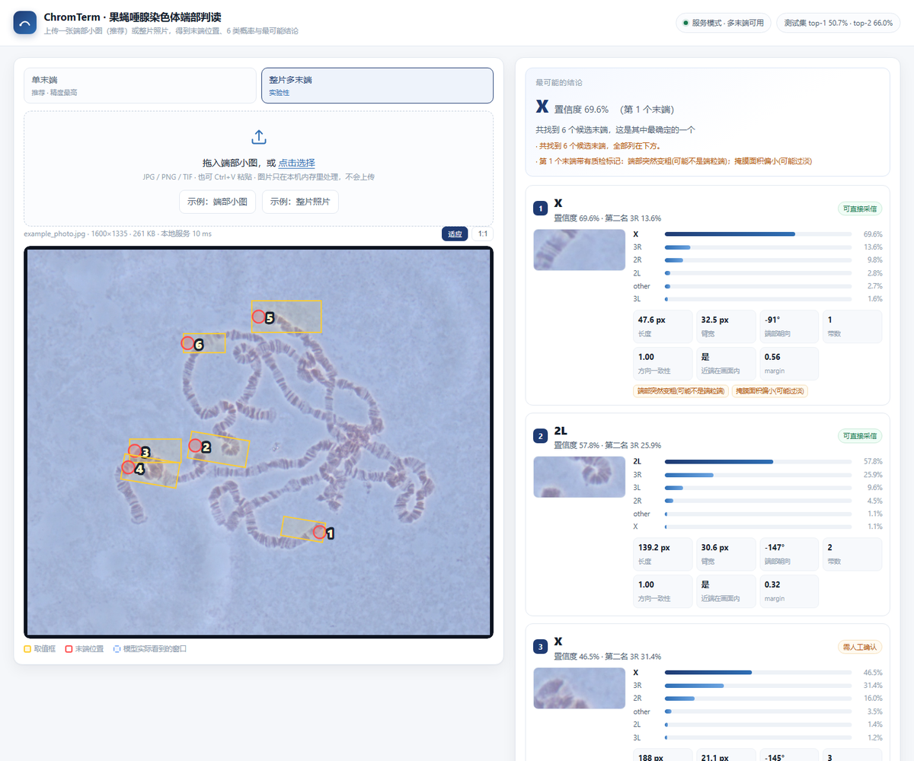
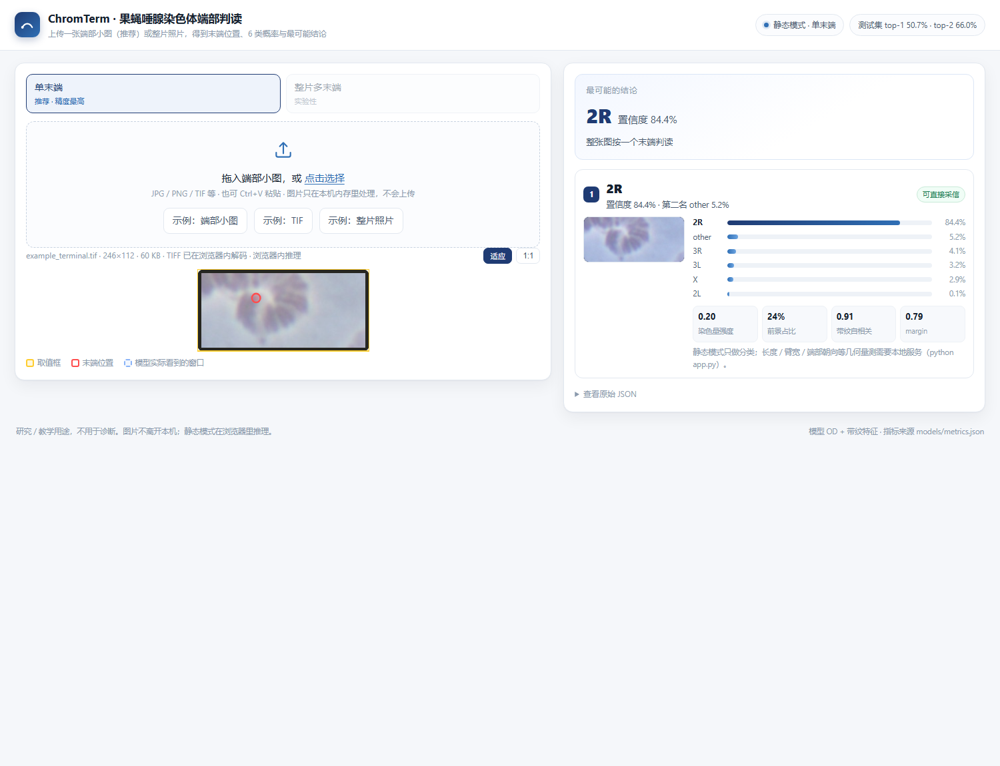

# ChromTerm · 果蝇唾腺染色体端部判读

**上传一张端部小图（推荐）或整片显微照片 → 找出染色体末端 → 给出 6 类（2L / 2R / 3L / 3R / X / other）的概率、置信度与「最可能的结论」；没有可识别末端时明确输出「无」。**

**在线版（GitHub Pages，纯前端、浏览器内推理）**：`https://<你的用户名>.github.io/ChromTerm/`
**本地版（可选后端，支持整片多末端）**：`python app.py --open`

推理全部手写：**numpy + Pillow**（Python）/ **纯 JavaScript**（浏览器），
没有 torch / OpenCV / SciPy / scikit-learn，也没有 Flask / FastAPI，**克隆下来就能跑**。



---

## 目录

- [两种运行方式](#两种运行方式)
- [输入什么、输出什么](#输入什么输出什么)
- [快速开始](#快速开始)
- [发布到 GitHub Pages](#发布到-github-pages)
- [HTTP 接口（本地服务）](#http-接口本地服务)
- [模型与实测指标](#模型与实测指标)
- [目录结构](#目录结构)
- [训练 / 复现（可选）](#训练--复现可选)
- [常见问题](#常见问题)
- [局限](#局限)

## 两种运行方式

| | 静态模式（GitHub Pages） | 服务模式（本地 `python app.py`） |
|---|---|---|
| 推理在哪 | 浏览器里，`assets/js/engine.js` | 本地 Python，`chromterm/` |
| 单末端判读 | 支持 | 支持（Python 实现） |
| 整片多末端 | 不可用（Pages 只有静态文件） | 实验性：骨架端点找 1–6 个候选 |
| 几何量测（长度/臂宽/端部朝向） | 不提供，只做分类 | 提供 |
| 隐私 | 图片不出浏览器 | 图片不出本机 |

页面会自动探测 `/api/info`：**能连上后端就走服务模式，连不上就退回静态模式**（并禁用「整片多末端」）。

## 输入什么、输出什么

**输入**：JPG / PNG / TIF。推荐 **单个端部**（如 246×112 的小图）——整张当作一个末端，精度最高；
输入格式：JPG / PNG / **TIF** / BMP / WebP。TIF 由页面内置解码器在浏览器里解（见「常见问题」）。

整片照片也能判读，但多条臂在染色中心粘连时容易选错，页面会明确提示。

**输出（JSON，界面只是它的可视化）**：

```jsonc
{
  "ok": true,
  "mode": "single",
  "n_terminals": 1,
  "image": {"w": 246, "h": 112},
  "verdict": {"cls": "2R", "conf": 0.769, "second": "other", "margin": 0.677,
              "terminal_id": 1, "reliable": true, "text": "整张图按一个末端判读"},
  "terminals": [{
      "id": 1,
      "x": 130.2, "y": 58.9,                            // 端部位置（原图坐标）
      "box": {"x0": 0, "y0": 0, "cw": 246, "ch": 111},  // 模型实际看到的窗口
      "quad": null,                                     // 多末端模式给四角多边形
      "cls": "2R", "conf": 0.769,
      "probs": [{"cls": "2R", "p": 0.769}],             // 6 类全给
      "second": "other", "conf2": 0.052, "margin": 0.784,
      "geo": {"length_px": 58.5, "width_px": 31.7, "tip_angle_deg": 108.2,
              "n_bands": 3.0, "coherence": 1.0, "prox_in_frame": true},
      "flags": ["近端不在画面内(长度不完整)"],
      "quality": "good",                                // good / fair / poor / cut
      "crop_png": "data:image/png;base64,..."           // 判读用的窗口（含叠加）
  }]
}
```

没有可识别末端时返回 `{"ok": false, "mode": "none", "n_terminals": 0, "reason": "..."}`，界面显示「判读结论：无」。

## 快速开始

要求 **Python ≥ 3.9**（只有服务模式需要；静态网页纯前端）。

```bash
git clone https://github.com/<your-name>/ChromTerm.git
cd ChromTerm
pip install -r requirements.txt      # numpy / pandas / Pillow
python app.py --open                 # → http://127.0.0.1:8770
```

只想看网页、不想装 Python：

```bash
python -m http.server 8000           # 浏览器打开 http://127.0.0.1:8000/
# 或者直接把仓库推到 GitHub，用 Pages 打开
```

> 直接双击 `index.html`（`file://`）会因浏览器的 ES module / CORS 限制而白屏，请用 http 方式打开。

页面上：

- 「示例：端部小图」 → `examples/example_terminal.jpg`，得到 2R（约 77%）
- 「示例：TIF」 → examples/example_terminal.tif（LZW 压缩、246×112），结果与 JPG 完全一致
- 「示例：整片照片」 → `examples/example_photo.jpg`，单末端模式会提示「像整片照片」；服务模式下切「整片多末端」可得 6 个候选
- `?demo=term` / `?demo=photo` / `?demo=blank` 便于演示与截图自检；`?mode=multi` 直接进多末端

## 发布到 GitHub Pages

仓库根目录已经有 `index.html`，**不需要构建**。两种做法：

**A. 分支直接发布（最简单）**

1. 推送到 GitHub（`main` 分支）。
2. Settings → Pages → Build and deployment → Source 选 **Deploy from a branch** → 分支 `main`、目录 `/ (root)` → Save。
3. 一两分钟后打开 `https://<你的用户名>.github.io/ChromTerm/`。

**B. 用附带的工作流发布（只发布网页文件）**

仓库已包含 `.github/workflows/pages.yml`：把 `index.html + assets/ + examples/` 收进 `_site` 再上传，
不会把 Python 代码与文档一起发出去。使用前把 Settings → Pages → Source 改成 **GitHub Actions**。

## HTTP 接口（本地服务）

| 方法 | 路径 | 说明 |
|---|---|---|
| GET | `/` | 前端页面（仓库根目录的 index.html） |
| GET | `/assets/<file>`、`/examples/<file>` | 前端、模型 JSON、示例图 |
| GET | `/api/info` | 模型信息 + 测试集指标 |
| GET | `/api/example` | 示例照片（`?kind=blank` 返回空白图，演示「无」） |
| POST | `/api/analyze?mode=single\|multi` | body 为图片字节 → 判读 JSON |

```bash
# 单末端（默认）
curl -s -X POST --data-binary @examples/example_terminal.jpg \
     -H "Content-Type: application/octet-stream" \
     "http://127.0.0.1:8770/api/analyze?mode=single"

# 整片多末端
curl -s -X POST --data-binary @examples/example_photo.jpg \
     -H "Content-Type: application/octet-stream" \
     "http://127.0.0.1:8770/api/analyze?mode=multi"
```

耗时参考（CPU）：端部小图 **0.1–0.3 s**（浏览器内约 40 ms 推理 + 读图）；1600×1335 整片照片 **3–5 s**。

## 模型与实测指标

**染色量 OD 图 → 6 类特征块（多尺度池化 / 带纹剖面 / 自相关 / 梯度方向直方图 / 粗细剖面 / 几何量测）
→ 收缩 LDA（α=0.6，836 维，无 PCA）+ 温度校准（T≈6.6，已折进权重）**，权重 30 KB。

在 961 个端部窗口（432 张原图、5 个成像批次）上，官方 test（150 个窗口）：

| 指标 | 数值 |
|---|---|
| top-1 准确率 | **51.3%**（95% CI 44.0–58.7%） |
| macro-F1 | **0.503** |
| top-2 准确率 | **72.7%**（第一版逻辑回归为 66.0%） |
| 重复 5 折分组 CV（15 折） | macro-F1 **0.475 ± 0.039** |
| 留一来源批次（LOSO） | 平均 **0.545**（单批次 0.40–0.73） |
| 按置信度接受 40% / 20% 的窗口 | 精度 **63.3% / 70.0%** |
| 校准误差 ECE | **0.109**（校准前 0.301；第一版逻辑回归 0.098） |
| 人为上限（10 张对照图 × 8 人标注） | 类别 κ=0.670、集合完全一致 0.65 |

**怎么读**：6 类单标签 + 单标注训练集本身带噪声（κ=0.67），50% 的 top-1 不是「模型不行」，
而是这个任务在现有标注下的真实水平；真正实用的是 **top-2 72.7% + 置信度拒识 + 人工确认**。
逐类看：2L 与 X 最好，2R/3L/3R 互相混淆最严重，other 最差（F1≈0.34）。

### 第二版（2026-11-02）：中线采样接入 + 校准

按组内《中线采样说明》把「沿中线采样」完整实现进了包（`chromterm/profile.py`、
`chromterm/pfeat.py`、`chromterm/build_profiles.py`、`chromterm/build_strips.py`），
并用同一套协议量出它值多少：

| 做法 | CV macro-F1 | 结论 |
|---|---|---|
| 2D 窗口特征（本仓库主线） | **0.475** | 保留 |
| 中线曲线 1D（新） | 0.289 | 明显更差 |
| 拉直长条 2D（新，48×96） | 0.314 | 明显更差 |
| 与窗口特征融合 | 0.455–0.475 | 无增益 |

采样实现本身是可靠的：在本仓库复现了说明书表 6 的统计（条带数中位 3.0、臂宽 42.0 px、
灰度–宽度相关 −0.26，见 `docs/profiles_stats.json`）。它对**测量**有用，
对**这个尺度上的识别**没用——端部窗口只覆盖约 3 个臂宽，一段短横纹序列不足以判臂。
独立证据：组里 53 条人工精细曲线做留一法 1-NN，DTW 只有 41.5%、欧氏 56.6%
（`docs/diagnosis.json`）。

真正有效的改动是分类器与决策层：收缩 LDA 把 top-2 从 66.0% 提到 72.7%；
温度校准把 ECE 从 0.301 压到 0.109（温度在 15 折折外预测上拟合，T=4.98；不改变 argmax，因此准确率不变）；
因为 (X@W+b)/T = X@(W/T) + b/T，校准被折进 W、b，所以**导出的仍是一个线性模型**，
本仓库的 Python 推理、HTTP 接口与浏览器引擎都不需要改动。

### 这份数据能回答多细的问题

| 问法 | 准确率 |
|---|---|
| 2L vs 非 2L | 84.7% |
| 2L / X / 其余（三组） | 74.0% |
| 四类（2R+3L+3R 合并） | 63.3% |
| 六类（原任务） | 51.3% |

→ 建议按「三组 + top-2 短名单 + 置信度」使用，把 2R/3L/3R 的细分标成「待确认」。

浏览器版与 Python 版共用同一套特征（`assets/js/engine.js` 是 Python 推理链的逐行移植）。
用导出的 JSON 权重在**官方 test 全部 150 个窗口**上逐一对过（Node 直接跑 `engine.js`）：

| 对照 | 结果 |
|---|---|
| top-1 判读一致率 | **94.0%**（141/150） |
| top-2 集合一致率 | **95.3%**（143/150） |
| 概率最大绝对差 | 0.076（平均 0.018） |
| 两边 test 准确率 | 浏览器 52.0% / Python 静态路径 50.0%（Python 完整版含几何块为 51.3%） |

不一致的 9 个窗口全部是"第一名与第二名概率差 < 0.03"的边界样本，差异来自
JS 与 Python 在双线性缩放、形态学闭运算边界上的浮点实现差异，不影响判读结论的性质。
浏览器版不做几何量测块（长度/臂宽/端部朝向），该块用训练均值代入——实测恰好与
Python 完整版的 51.3% 差在噪声内，所以静态网页不需要移植骨架化那一整套。

细节、消融与负结果见 [`docs/说明_模型改进.docx`](docs/说明_模型改进.docx)
（第一版归档在 `docs/说明_模型改进_v1.docx`）：
光密度归一化 +0.17 macro-F1；几何转正与端部锚定裁剪**不加分反而降点**；几何特征块贡献≈0；
随机特征 + 岭回归不如线性；**中线采样曲线与拉直长条都不如 2D 窗口特征**。

## 目录结构

```
ChromTerm/
├── index.html                GitHub Pages 入口（静态版，浏览器内推理）
├── assets/
│   ├── style.css  app.js     前端（原生，无构建）
│   ├── js/engine.js          浏览器端推理引擎（Python 推理链的 JS 移植）
│   ├── js/tiff.js            浏览器端 TIFF 解码（LZW / Deflate / PackBits / 8·16 位）
│   └── model/model_best.json 网页用权重（836 维 + 指标，75 KB）
├── app.py                    本地服务启动器（python app.py）
├── chromterm/                Python 包：同一套推理 + 多末端 + HTTP 服务
│   ├── common.py prep_od.py geometry.py normalize.py features.py model.py
│   ├── profile.py        ★   沿中线采样（《中线采样说明》的口径）+ 拉直长条
│   ├── pfeat.py          ★   曲线 → 识别特征；DTW 原型；匈牙利容量指派
│   ├── build_profiles.py ★   采样缓存（逐点曲线 + 条带表）
│   ├── build_strips.py   ★   拉直长条缓存（48×96）
│   ├── detect_terminals.py   单 / 多末端流程
│   ├── pipeline.py           Predictor（加载模型、端到端）
│   ├── webapp.py             标准库 HTTP 服务
│   └── viz.py cli.py
├── models/
│   ├── model_best.npz        Python 权重（30 KB，含温度已折入的 W/b）
│   └── metrics.json          指标（界面与报告共用同一来源）
├── examples/                 示例图（整片 + 端部窗口）
├── docs/                     截图与完整报告（含第一版归档）
├── tools/                    训练 / 评估 / 体检 / 导出网页模型 / 诊断
└── tests/                    冒烟测试（含「网页资产自洽」检查）
```

## 训练 / 复现（可选）

推理不需要数据集；下面的脚本需要把数据集放到 `data_share/`（或用 `CHROMTERM_DATA` 指向别处），
格式与 `dataset/level1`、`dataset/det` 一致（YOLO 框 + 246×112 端部窗口）。

```bash
export CHROMTERM_DATA=/path/to/data_share      # Windows: set CHROMTERM_DATA=...
python tools/build_cache.py          # 预处理缓存（961 窗口，5–15 分钟）
python tools/build_profiles.py       # 沿中线采样缓存（约 4 分钟）
python tools/build_strips.py         # 拉直长条缓存（约 7 分钟）
python tools/train_final.py          # 消融 + 校准 + 拒识（约 80 秒，单线程 BLAS 可复现）
python tools/diagnose.py             # 四条诊断证据（约 1 分钟）
python tools/export_web_model.py     # 由 npz 生成 assets/model/model_best.json（网页用）
python tools/write_metrics.py        # 由 runs/summary_final.json 生成 models/metrics.json
python tools/audit_dataset.py        # 数据体检与 8 人标注一致性
```

> 第一版的 `tools/train_classifier.py` 保留原样，便于对照复现。
> 训练需要 `data_share/` 与 `_cache/`（都不随仓库分发，`.gitignore` 已忽略）。

`tests/` 里的测试不依赖数据集（只用 `examples/`），`python -m pytest -q` 即可。

## 常见问题

**双击 index.html 白屏**：浏览器不允许 `file://` 下的 ES module，用 `python -m http.server` 或 Pages 打开。
**.tif 打不开 / 以前报「解码失败」**：Chrome / Edge / Firefox 的  不支持 image/tiff（只有 Safari 能解）。
页面已内置 ssets/js/tiff.js：支持不压缩 / LZW / Deflate / PackBits、8 位与 16 位、灰度 / RGB / 调色板、按条带存储；
分块（tiled）或 JPEG 压缩的 TIFF 会提示另存为 PNG/JPG（这类文件在本地服务模式下仍可由 PIL 判读）。



**GitHub Pages 上「整片多末端」是灰的**：静态托管没有后端，只能跑单末端；整片需要本地 `python app.py`。
**标注框/点偶尔不显示**：已在 `assets/app.js` 里修掉——图片解码完成前不画（否则 SVG 尺寸为 0）、
换图先清空、用 `ResizeObserver` 同步 SVG 尺寸、大图按 `原图/推理图` 比例换算坐标。
**端口被占用**：`python app.py --port 9000`。
**一张图识别出很多候选但有的不像末端**：多末端是**启发式**（骨架端点 + 打分），不是训练出来的检测器。

## 局限

- **研究 / 教学用途**，不是医疗器械，不能用于诊断。
- 单末端是主路径；整片多末端为实验性候选，粘连 / 遮挡处会误检或漏检。
- 6 类之间本身难分（2R/3L/3R 在端部几个臂宽内高度相似），请以 top-2 + 人工确认为准。
- 跨批次泛化有限：LOSO 单批次最低 0.42。

## 致谢与引用

- 数据与标注口径来自项目组 8 位同学的 `data_share` 数据集与《端部图像处理流程说明》。
- 若用于发表，请引用本仓库与上述数据集说明。参见 `CITATION.cff`。

## License

MIT（见 [LICENSE](LICENSE)）。数据集不随仓库分发，其使用请遵循原提供方约定。
